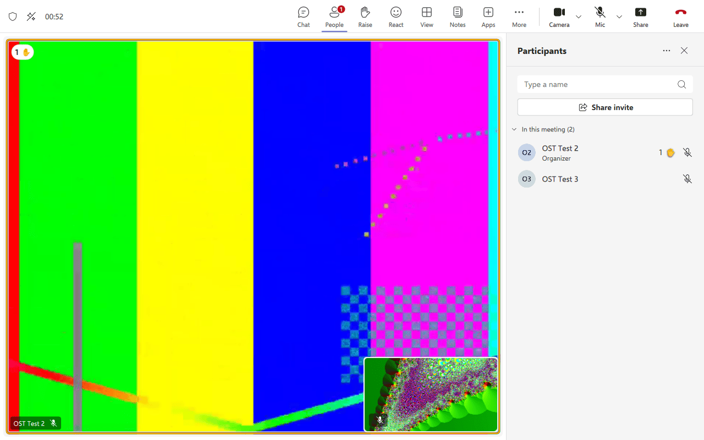
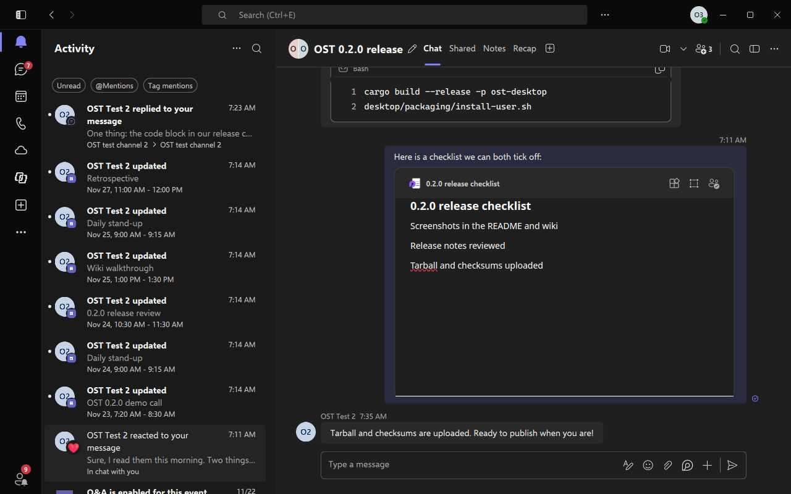

<p align="center"></p>

<h1 align="center">OST</h1>

<p align="center">
  <b>The Microsoft Teams desktop experience, native on Linux.</b><br>
  Chat, channels, calls and meetings, calendar and files, built in Rust and Qt Quick.
</p>

<p align="center">
  <a href="https://github.com/RandyNorthrup/ost/releases/latest"></a>
  <a href="https://github.com/RandyNorthrup/ost/releases"></a>
  <a href="https://github.com/RandyNorthrup/ost/stargazers"></a>
  <a href="https://github.com/RandyNorthrup/ost/actions/workflows/ci.yml"></a>
  <a href="LICENSE"></a>
</p>

<p align="center">
  <a href="#install"><b>Install</b></a> ·
  <a href="#features"><b>Features</b></a> ·
  <a href="#screenshots"><b>Screenshots</b></a> ·
  <a href="https://github.com/RandyNorthrup/ost/wiki"><b>Wiki</b></a> ·
  <a href="#build-from-source"><b>Build</b></a> ·
  <a href="#contributing"><b>Contributing</b></a>
</p>

---

**OST is a native Linux clone of the Microsoft Teams desktop app for
Windows.** It looks and works like Teams, one to one: the same app bar,
chat list, conversations, channels, calendar, call and meeting windows,
settings and dialogs, measured from Teams itself. Only the name and the
logo differ. It has its own calling and media engine, and also includes the
original terminal client, `teams-cli`. *Ost* means cheese in Danish.

> [!IMPORTANT]
> OST is an independent open-source project. It is **not affiliated with,
> endorsed by or supported by Microsoft.** You sign in with your own
> Microsoft work or school account, on Microsoft's own sign-in page.

<p align="center"></p>

## Features

<table>
<tr>
<td width="50%" valign="top">

### Chat
1:1, group and meeting chats with Teams' formatting, code blocks, emoji,
GIFs, reactions, files from your computer or OneDrive, Loop components,
video clips, scheduled messages, @mentions, read receipts, drafts, find in
chat and search.

</td>
<td width="50%" valign="top">

### Teams and channels
Posts and threads layouts, replies, announcements, Teams' post composer,
followed threads, channel tabs (Shared, Page, Notes, apps), shared and
private channels, and managing teams and channels.

</td>
</tr>
<tr>
<td valign="top">

### Calls and meetings
1:1 and group calls, meetings with video and background effects, screen and
window sharing, raise hand, reactions, live captions, recording and
transcripts, breakout rooms, town halls and webinars, hold, transfer and
park, voicemail, Meeting Recaps and audio recaps.

</td>
<td valign="top">

### Calendar
Day, work week, week and month views, event cards, RSVP, Teams' scheduling
form, Outlook's event form for your events and invitations (series edits,
time suggestions, the body editor's tools), Meet now and Join with an ID.

</td>
</tr>
<tr>
<td valign="top">

### Files
OneDrive (Home, My files, Shared, Libraries, Recycle bin), channel files,
previews, version history, sharing, and Teams' cloud file picker.

</td>
<td valign="top">

### Copilot
With a Microsoft 365 Copilot license: Copilot in chats, meeting chats and
channel threads, and Write with Copilot in the message box.

</td>
</tr>
<tr>
<td valign="top">

### Apps
Teams' app bar and Store; People, Events and Meeting Recaps drawn natively;
Planner, OneNote, Whiteboard and other apps hosted the way Teams hosts them.

</td>
<td valign="top">

### Activity and notifications
Teams' activity feed, live and synced with Teams, and Teams' notification
banners with quick reply, presence and status messages.

</td>
</tr>
<tr>
<td valign="top">

### Settings and accessibility
Every Teams Settings page, synced with your account; light, dark and
high-contrast themes; Teams' keyboard shortcuts (Ctrl+. lists them);
built-in Help (F1); every Teams app language.

</td>
<td valign="top">

### Teams Rooms and devices
Run OST as a Teams Rooms device, cast to a room, join with a room's audio,
control a room from your laptop, and use headset call controls over USB
and Bluetooth.

</td>
</tr>
</table>

What OST knowingly does differently from Teams (Linux sign-in, the
desktop's screen-share picker, feedback going to GitHub, no telemetry and
so on) is listed in
[Differences from Teams](https://github.com/RandyNorthrup/ost/wiki/Differences-from-Teams). The
[wiki](https://github.com/RandyNorthrup/ost/wiki) documents every feature with screenshots.

## Screenshots

<table>
  <tr>
    <td width="50%"><p align="center"><sub>Meetings with video, raised hands and the People pane</sub></p></td>
    <td width="50%"><p align="center"><sub>The calendar's work week view</sub></p></td>
  </tr>
  <tr>
    <td><p align="center"><sub>Channel posts and replies</sub></p></td>
    <td><p align="center"><sub>Activity in the dark theme</sub></p></td>
  </tr>
</table>

## Install

Every [release](https://github.com/RandyNorthrup/ost/releases/latest) has
native packages built against each distribution's own Qt 6, FFmpeg and
WebRTC audio processing, a Flatpak bundle, and an AppImage for everything
else. Each package has the desktop app `ost-desktop` (menu entry **OST**)
and the terminal client `teams-cli` (its own package for .deb and .rpm).
Check your download against the release's `SHA256SUMS`
(`sha256sum -c SHA256SUMS --ignore-missing`).

| System | Download | Install |
| --- | --- | --- |
| Ubuntu 26.04 | `ost-desktop_<version>-1.ubuntu26.04_amd64.deb` | `sudo apt install ./ost-desktop_*.ubuntu26.04_amd64.deb` |
| Debian testing (forky) | `ost-desktop_<version>-1.debian.forky_amd64.deb` | `sudo apt install ./ost-desktop_*.debian.forky_amd64.deb` |
| Fedora 45 | `ost-desktop-<version>-1.fc45.x86_64.rpm` | `sudo dnf install ./ost-desktop-*.fc45.x86_64.rpm` |
| openSUSE Tumbleweed | `ost-desktop-<version>-1.suse.tw.x86_64.rpm` | `sudo zypper install --allow-unsigned-rpm ./ost-desktop-*.suse.tw.x86_64.rpm` |
| Arch Linux | AUR `ost` / `ost-bin` (coming soon) | |
| Any, with Flatpak | `OST-<version>-x86_64.flatpak` | `flatpak install --user ./OST-*-x86_64.flatpak` (with the Flathub remote set up, for the KDE runtime) |
| Any, glibc 2.43+ | `OST-<version>-x86_64.AppImage` | `chmod +x OST-*-x86_64.AppImage && ./OST-*-x86_64.AppImage` |

Add `teams-cli_*.deb` or `teams-cli-*.rpm` to the same command for the
terminal client. apt, dnf and zypper pull in the libraries OST needs;
removing the package (`sudo apt remove ost-desktop`, `sudo dnf remove
ost-desktop`) removes it again. Fedora's and openSUSE's own FFmpeg leave out
some patented codecs; if a video clip doesn't play, install the full FFmpeg
from RPM Fusion or Packman.

To add the AppImage to your app menu, use the release's
`ost-<version>-linux-x86_64.tar.gz` (the same AppImage with the install
scripts):

```bash
tar xf ost-*-linux-x86_64.tar.gz
cd ost-*-linux-x86_64
sh packaging/install-user.sh ./OST-*-x86_64.AppImage   # ~/.local/bin/ost-desktop, menu entry and icon
ost-desktop
```

**Supported systems:** 64-bit x86 Linux on Wayland or X11. Your system
provides the graphics drivers, PipeWire for audio, a Secret Service keyring
(GNOME Keyring or KWallet) and, for screen sharing, xdg-desktop-portal with
your desktop's backend; the AppImage also needs glibc 2.43 or newer and FUSE
3 (`fuse3`). On other systems, build from source as below. More in
[Installation](https://github.com/RandyNorthrup/ost/wiki/Installation).

On first start OST shows Microsoft's sign-in page; sign in with your work or
school account. Settings ▸ About OST checks GitHub for newer releases.

**Bluetooth headsets:** mute works out of the box. Answering and ending
calls with the headset's button needs a one-time PipeWire setup:
`sh /usr/share/ost-desktop/install-hfp-calls.sh` with the .deb or .rpm, or
`sh packaging/install-hfp-calls.sh` from the tarball (it asks before
changing anything that needs `sudo`; `--uninstall` undoes it; not available
in the Flatpak). See
[Bluetooth headsets](https://github.com/RandyNorthrup/ost/wiki/Bluetooth-headsets).

## Build from source

<details>
<summary><b>Requirements, commands and packaging</b></summary>

Requirements: Rust stable (edition 2024), Qt 6.9 or newer with Qt Quick,
Quick Controls, Multimedia, WebEngine and the shader tools, a C++ compiler,
CMake, FFmpeg's development libraries, the ALSA and PipeWire development
files, clang, NASM, pkg-config, and the OpenSSL and WebRTC audio
processing (`webrtc-audio-processing-1`) development files.

```bash
# Arch
sudo pacman -S qt6-base qt6-declarative qt6-svg qt6-multimedia qt6-webengine qt6-shadertools ffmpeg alsa-lib cmake nasm \
  pipewire clang xdg-desktop-portal openssl webrtc-audio-processing-1 pkgconf
# Debian / Ubuntu
sudo apt install qt6-base-dev qt6-declarative-dev qml6-module-qtquick-controls \
  qml6-module-qtquick-window qml6-module-qtquick-shapes qml6-module-qtquick-effects qml6-module-qtquick-dialogs libqt6svg6 qml6-module-qtmultimedia qt6-webengine-dev qml6-module-qtwebengine qt6-shader-baker \
  libavfilter-dev libavformat-dev libavcodec-dev libavutil-dev libswscale-dev \
  libasound2-dev cmake nasm libpipewire-0.3-dev clang xdg-desktop-portal \
  libssl-dev libwebrtc-audio-processing-dev pkg-config

cargo build --release -p ost-desktop       # target/release/ost-desktop
desktop/packaging/install-user.sh          # installs target/release/ost-desktop for your user
```

The C++ parts are heavy; on machines with little memory use
`cargo build -j 2 --release -p ost-desktop`. To package your build as an
AppImage, also build `teams-cli` (`cargo build --release --bin teams-cli
--features audio`) and run `sh desktop/packaging/build-appimage.sh <version>`.
`desktop/packaging/build-deb.sh` and `build-rpm.sh` build the .deb and .rpm
packages on the distribution they are for (`--deps` installs the build
dependencies first); `.github/workflows/release.yml` builds every package
for a release. More in
[Building from source](https://github.com/RandyNorthrup/ost/wiki/Building-from-source)
and [docs/desktop.md](docs/desktop.md).

</details>

## Terminal client

<details>
<summary><b>teams-cli: the terminal interface and commands</b></summary>

`teams-cli` is OST's terminal client: a full-screen terminal interface for
teams, channels and chats, plus commands for scripts. It shares the engine,
account profiles and sign-in storage with the desktop app.


```bash
./OST-*-x86_64.AppImage teams-cli tui                    # from the AppImage, or build it:
cargo build --release --bin teams-cli                    # or --features audio for calls with sound
teams-cli login            # device-code sign-in (skipped when already signed in)
teams-cli tui              # the terminal interface (? for its keys)
teams-cli chats            # recent chats and their ids
teams-cli read <chat-id> --limit 20
teams-cli send --to <chat-id> "Hello from the terminal"
teams-cli teams            # teams and channels
teams-cli presence --set busy
teams-cli call-test --echo --duration 20                 # test call with Teams' echo bot
```

`teams-cli --help` lists every command:

```
login      Authenticate with Microsoft Teams (--force to sign in again)
logout     Log out and clear cached credentials
status     Show current authentication status
chats      List recent chats (--limit N, default 20)
read       Read messages from a chat (<chat-id>, --limit N)
send       Send a message (--to <chat-id> <message>)
teams      List joined teams and their channels
whoami     Show current user info (verify auth works)
trouter    Connect to Trouter WebSocket push service
presence   Get/set presence status (--set available|busy|dnd|away|offline)
call-test  Place a test call (--echo, --thread <id>, --duration N (default 15),
           --record, --tone, --camera, --display)
mic-test   Test microphone capture (builds with the audio feature)
cam-test   Test camera capture (builds with the video-capture feature)
tui        Launch the terminal user interface
```

See [Terminal client](https://github.com/RandyNorthrup/ost/wiki/Terminal-client).

</details>

## Configuration

<details>
<summary><b>Files, keyring and profiles</b></summary>

Settings live in OST's Settings (Ctrl+,). On disk: `~/.config/ost/desktop.json`
(this computer's settings), `~/.config/teams-cli/config.toml` (account
settings, no secrets), the log in `~/.local/state/ost/ost-desktop.log`, and
caches under `~/.cache/ost/`. Sign-in tokens are kept in the system keyring
(Secret Service); without one, or with `OST_NO_KEYRING=1`, they go to
`config.toml`, readable only by you. `OST_PROFILE=<name>` runs another
account. All files and environment variables:
[Configuration](https://github.com/RandyNorthrup/ost/wiki/Configuration).

</details>

## Testing

<details>
<summary><b>Unit and end-to-end tests</b></summary>

```bash
cargo test --workspace     # unit tests: engine, desktop backend, video effects
just check                 # rustfmt check, clippy, and compile the tests
just e2e                   # terminal client end-to-end tests (needs a signed-in test account)
```

The desktop app is also its own end-to-end test driver: given a PNG path and
a test flag it drives itself against the signed-in account, captures
pictures and quits. Use a test account; these tests send real messages and
schedule real meetings. The flags are listed in
[docs/desktop.md](docs/desktop.md#test-harness).

</details>

## Documentation

- [OST wiki](https://github.com/RandyNorthrup/ost/wiki): installation, feature tour, configuration, troubleshooting, FAQ
- [docs/desktop.md](docs/desktop.md): the desktop app's features, environment variables, keyboard shortcuts and test harness
- [docs/spec](docs/spec): measured specifications of the Teams surfaces OST follows
- [docs/help](docs/help): the built-in Help articles
- [docs/architecture.md](docs/architecture.md), [docs/terminology_index.md](docs/terminology_index.md), [docs/GUIDs.md](docs/GUIDs.md): protocols and the engine

## Feedback and privacy

In OST, Settings and more ▸ Feedback (Report a problem, Give a compliment,
Suggest a feature) opens a pre-filled public issue or discussion on this
repository, which you review and submit yourself. OST has no telemetry and
sends nothing to the project. See [SUPPORT.md](SUPPORT.md) and
[PRIVACY.md](PRIVACY.md).

## Contributing

Contributions are welcome: see [CONTRIBUTING.md](CONTRIBUTING.md) for how to
build, test and match a feature to Teams, and
[CODE_OF_CONDUCT.md](CODE_OF_CONDUCT.md). Report security problems
privately as [SECURITY.md](SECURITY.md) describes, not in a public issue.

## Authors

<table>
  <tr>
    <td align="center"><a href="https://github.com/RandyNorthrup"><br><b>Randy Northrup</b></a></td>
    <td align="center"><a href="https://github.com/eisbaw"><br><b>Mark Ruvald Pedersen</b></a></td>
  </tr>
</table>

OST grew out of Mark Ruvald Pedersen's [eisbaw/ost](https://github.com/eisbaw/ost).

## License

MIT License, see [LICENSE](LICENSE). Third-party assets and their licenses
are listed in [desktop/assets/NOTICE.md](desktop/assets/NOTICE.md) and
[desktop/THIRD-PARTY-NOTICES.md](desktop/THIRD-PARTY-NOTICES.md).

## Disclaimer

> [!NOTE]
> OST is an unofficial client, provided as is; use it at your own risk and
> within your organization's policies. It is not affiliated with, endorsed by
> or supported by Microsoft. Microsoft, Microsoft Teams, Microsoft 365,
> OneDrive, Outlook, Loop and Copilot are trademarks of the Microsoft group of
> companies.

## Related projects

- [purple-teams](https://github.com/EionRobb/purple-teams/): Teams plugin for libpurple (Pidgin, Finch, etc.)
