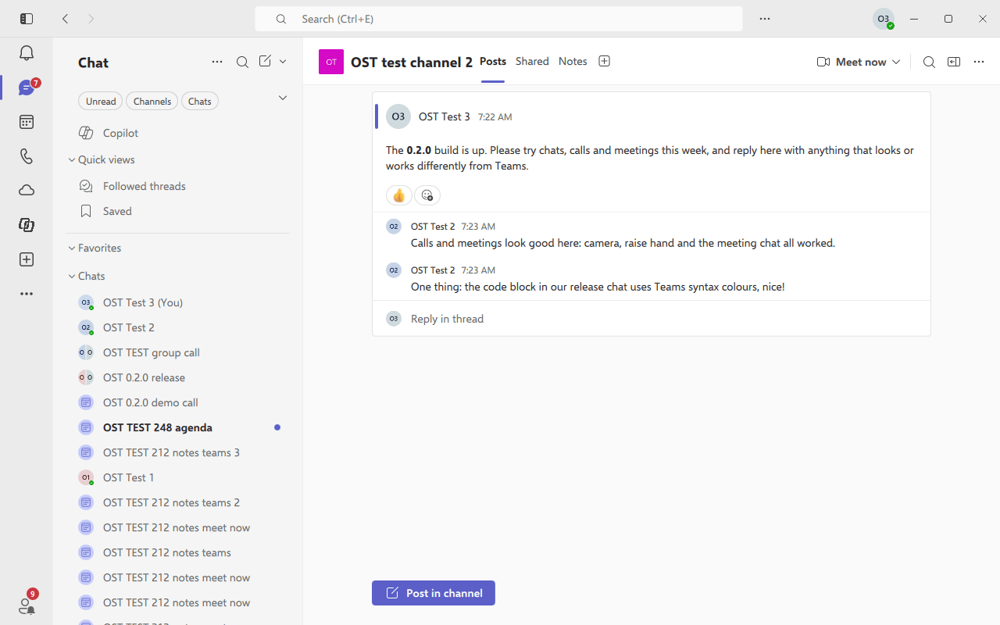
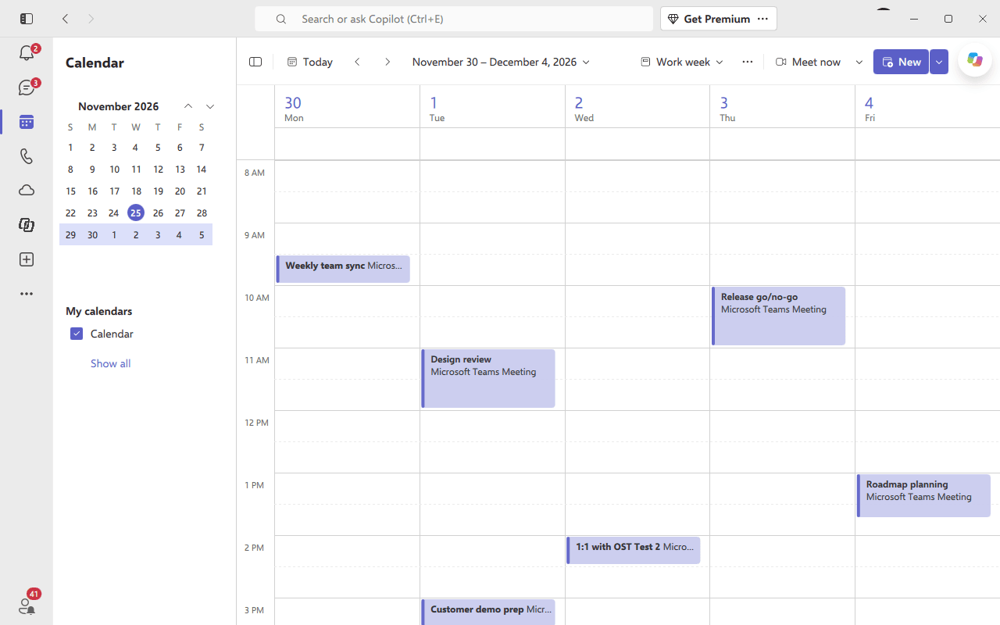
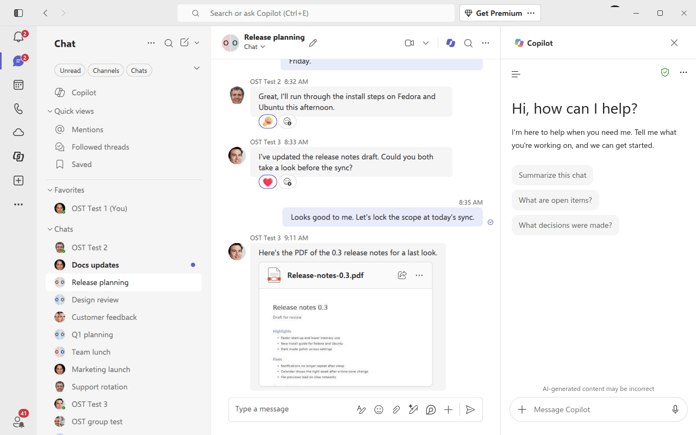

<p align="center"></p>

<p align="center">
  <b>The Microsoft Teams desktop app, rebuilt natively for Linux.</b>
</p>

<p align="center">
  <a href="https://github.com/RandyNorthrup/ost/releases/latest"></a>
  <a href="https://github.com/RandyNorthrup/ost/releases"></a>
  <a href="https://github.com/RandyNorthrup/ost/stargazers"></a>
  <a href="https://github.com/RandyNorthrup/ost/actions/workflows/ci.yml"></a>
  <a href="LICENSE"></a>
  <a href="https://github.com/sponsors/RandyNorthrup"></a>
</p>

<p align="center">
  <a href="#install">Install</a> ·
  <a href="#features">Features</a> ·
  <a href="https://github.com/RandyNorthrup/ost/wiki">Wiki</a> ·
  <a href="#development">Development</a> ·
  <a href="#sponsor">Sponsor</a>
</p>

OST looks and works like Teams for Windows, screen for screen: chat,
channels, calls and meetings, calendar, files and settings. It is written
in Rust with a Qt Quick interface and has its own calling and media engine,
so it runs as a real desktop app, not a web page in a window. Sign in with
your Microsoft work or school account.

<p align="center"></p>

## Install

Download your package from the
[latest release](https://github.com/RandyNorthrup/ost/releases/latest), then:

| System | Command |
| --- | --- |
| Ubuntu 26.04 | `sudo apt install ./ost-desktop_*.ubuntu26.04_amd64.deb` |
| Debian testing | `sudo apt install ./ost-desktop_*.debian.forky_amd64.deb` |
| Fedora 45 | `sudo dnf install ./ost-desktop-*.fc45.x86_64.rpm` |
| openSUSE Tumbleweed | `sudo zypper install --allow-unsigned-rpm ./ost-desktop-*.suse.tw.x86_64.rpm` |
| Flatpak | `flatpak install --user ./OST-*-x86_64.flatpak` |
| Any distribution | `chmod +x OST-*-x86_64.AppImage && ./OST-*-x86_64.AppImage` |

Arch Linux packages are coming to the AUR. OST runs on 64-bit x86 Linux
with Wayland or X11. Requirements, checksums, the terminal client package,
updating and uninstalling are covered in
[Installation](https://github.com/RandyNorthrup/ost/wiki/Installation).
Every release file has a build-provenance attestation: check one with
`gh attestation verify <file> -R RandyNorthrup/ost`
([Verifying a download](SECURITY.md#verifying-a-download)).

## Features

### Chat and channels

One-to-one, group and meeting chats with Teams' formatting, code blocks,
reactions, files, Loop components, video clips and scheduled messages.
Channels have Teams' posts and threads layouts, replies, announcements and
tabs.

<p align="center"></p>

### Calls and meetings

Video calls and meetings with background effects, screen sharing, raised
hands, reactions, live captions, recording, breakout rooms, town halls and
webinars, plus call transfer, park and voicemail.

<p align="center"></p>

### Calendar

Day, work week, week and month views, RSVP, and Teams' scheduling form for
new meetings, with Meet now and Join with an ID.

<p align="center"></p>

### Copilot

With a Microsoft 365 Copilot license, Copilot works in chats, meetings and
channels, and helps you write messages.

<p align="center"></p>

### Also included

- **Files:** OneDrive, channel files, previews, version history and sharing.
- **Activity and notifications:** Teams' activity feed and notification
  banners with quick reply.
- **Apps:** Teams' app store, with Planner, OneNote, Whiteboard and other
  apps hosted the way Teams hosts them.
- **Settings:** every Teams settings page, synced with your account; light,
  dark and high-contrast themes; every Teams language.
- **Teams Rooms and devices:** room mode, casting to a room, and headset
  call controls over USB and Bluetooth.
- **Terminal client:** `teams-cli`, a full-screen terminal interface for
  chats and channels, plus commands for scripts.

The [wiki](https://github.com/RandyNorthrup/ost/wiki) documents every
feature with screenshots. Where OST deliberately differs from Teams, such as
sign-in on Linux, your desktop's screen-share picker and no telemetry, see
[Differences from Teams](https://github.com/RandyNorthrup/ost/wiki/Differences-from-Teams).

## Support and privacy

Questions and bug reports go to
[GitHub issues](https://github.com/RandyNorthrup/ost/issues). In the app,
Settings and more ▸ Feedback opens a pre-filled issue that you review and
submit yourself. OST has no telemetry and sends nothing to the project; see
[PRIVACY.md](PRIVACY.md). Report security problems privately as described
in [SECURITY.md](SECURITY.md).

## Development

OST builds with Rust stable and Qt 6.9 or newer:

```bash
cargo build --release -p ost-desktop
cargo test --workspace
```

The build dependencies for each distribution are listed in
[Building from source](https://github.com/RandyNorthrup/ost/wiki/Building-from-source).
Before opening a pull request, read [CONTRIBUTING.md](CONTRIBUTING.md) and
the [code of conduct](CODE_OF_CONDUCT.md). Architecture and protocol notes
live in [docs/](docs/).

## Sponsor

OST is built and maintained in spare time and is free for everyone. If it
saves you a browser tab every workday, you can help keep it going.

<p align="center">
  <a href="https://github.com/sponsors/RandyNorthrup"></a>
  &nbsp;
  <a href="https://www.paypal.com/donate/?hosted_button_id=Q9VC7B42R7K82"></a>
</p>

## Authors

<table>
  <tr>
    <td align="center"><a href="https://github.com/RandyNorthrup"><br>Randy Northrup</a></td>
    <td align="center"><a href="https://github.com/eisbaw"><br>Mark Ruvald Pedersen</a></td>
  </tr>
</table>

OST grew out of Mark Ruvald Pedersen's [eisbaw/ost](https://github.com/eisbaw/ost).
*Ost* is Danish for cheese.

## License

MIT, see [LICENSE](LICENSE). Third-party assets are listed in
[NOTICE.md](desktop/assets/NOTICE.md) and
[THIRD-PARTY-NOTICES.md](desktop/THIRD-PARTY-NOTICES.md).

OST is an independent project, not affiliated with, endorsed by or
supported by Microsoft. Microsoft, Microsoft Teams, Microsoft 365, OneDrive,
Outlook, Loop and Copilot are trademarks of the Microsoft group of
companies.
